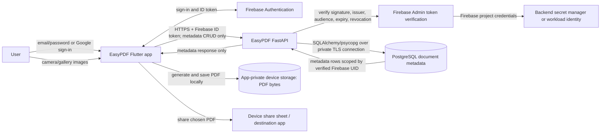

# EasyPDF: project RCA, data flow, security, and SDLC

## Scope and conclusion

This is a source-code and configuration review of the repository, not a
post-incident report. No production deployment, Firebase console, PostgreSQL
instance, Play Console submission, runtime telemetry, or store review was
available to inspect. Findings describe what the checked-in code does and what
must still be verified in the real environments.

The current design is a Flutter app that creates PDFs locally, Firebase
Authentication for identity, and a FastAPI service with PostgreSQL for a small
amount of account-scoped PDF history. The PDF bytes are not sent to the API.
The codebase is not yet a production or Play Store release: deployment,
account deletion, privacy disclosures, production credentials, and device/store
validation remain release gates.

## Root-cause analysis and changes

| Observed issue | Root cause | Change in this project | Remaining validation |
| --- | --- | --- | --- |
| Dashboard actions did not start a usable image-to-PDF flow. | The dashboard actions were presentation-only feedback rather than connected navigation. | Connected camera/gallery actions to source selection, page preview, PDF generation, saving, and sharing; added recent metadata history. | Exercise camera, gallery, sharing, API outage, and navigation on physical devices. |
| Sign-in code navigated to a named dashboard route that was not registered. | The route string and `MaterialApp` route table were out of sync. | Registered `/dashboard` and retained auth-state-based initial navigation. | Test email/password and Google auth on configured Firebase clients. |
| Gallery recrop could act on a different selected image. | The scanner plugin opened its own gallery UI instead of operating on the selected file. | Replaced that operation with an explicit single-image replacement picker. | Confirm platform permission and picker behavior on supported Android/iOS versions. |
| PDF work had no explicit input/page bounds. | Input count and encoded bytes were not capped, and images were embedded without downsampling. | Added a 50-page cap, per-image and total-byte caps, image resizing/compression in an isolate, and filename validation. | Test malformed/large images and peak memory on low-memory devices; the compressed-file limits do not replace device-level memory testing. |
| Signup could fail after Firebase had already created an account. | A separate Firestore profile write was part of auth success and could fail independently. | Moved display name to Firebase Auth and removed Firestore profile writes from the auth flow. | Remove unused database packages after resolving Flutter dependencies; verify Firebase project settings. |
| A release build could be signed with the debug key. | The starter Gradle release configuration explicitly reused the debug signing config. | Added a release-only properties-based signer; no debug-signing fallback is configured. | Generate and protect a real upload keystore; verify the signed AAB and Play App Signing setup. |
| Permission and transport defaults were too broad/unsafe for release. | Starter platform manifests had broad photo permissions and did not distinguish release transport policy. | Removed broad photo-library permissions, added camera/usage descriptions, set release cleartext traffic off and backups off on Android, and enabled development-only cleartext in the debug manifest. | Inspect the merged release manifest and test permission prompts and backup behavior. |
| The first backend default exposed interactive API docs. | `APP_ENV` defaulted to development, so a deployment omitting the variable would leave docs enabled. | The default is now production; docs/OpenAPI are enabled only when explicitly set to development. | Confirm deployment explicitly sets `APP_ENV=production` and test the deployed routes. |
| The API could accept badly typed optional identity claims. | Only the UID type was validated before constructing the response model. | Reject malformed UID, email, or display-name claims rather than allowing a response-validation error. | Keep token verification tests in CI and check Firebase project/audience configuration in deployment. |

These are source-level root causes, not proof that an exploit or production
incident occurred. The historical changes are in commit `4f00dc0`; subsequent
changes to this document and fail-closed API defaults are described by the
current branch diff.

## Data-flow diagram (DFD)

### Data and trust boundaries

- **Device boundary:** source images and PDF bytes are processed/saved on the
  device. The current API does not receive or store PDF bytes. PDFs may still be
  copied when the user explicitly shares them; treat the destination app as an
  external recipient.
- **Identity boundary:** Firebase signs ID tokens. The API verifies tokens
  server-side with Firebase Admin and uses the verified `uid`; it does not take
  an owner ID from the request body.
- **Network boundary:** mobile-to-API traffic must use HTTPS in release builds.
  Redirects are disabled so a bearer token is not forwarded to a redirect
  destination.
- **Database boundary:** the backend connects to PostgreSQL. The mobile app
  never receives database credentials or connects directly to PostgreSQL.
- **Secrets boundary:** Firebase Admin credentials and database credentials
  belong only in backend workload identity/secret management. Do not ship them
  in Flutter assets or commit them.
- **Synced metadata:** filename, page count, file size, creation time, and
  Firebase UID are stored server-side. A filename can reveal personal
  information, so disclose this in the privacy notice and Data safety form.

## API and PostgreSQL request lifecycle

1. A user signs in using Firebase Authentication. The app obtains a Firebase ID
   token and sends it as an authorization bearer token to the configured HTTPS
   API URL.
2. FastAPI's authentication dependency verifies the token with Firebase Admin,
   including revocation checking. Invalid tokens are rejected; Firebase
   verification outages return a service-unavailable response.
3. The API derives the owner UID only from verified claims. Pydantic validates
   request fields; `owner_uid` is not an accepted client field.
4. SQLAlchemy maps the document metadata model to PostgreSQL using the backend
   `DATABASE_URL` and the psycopg driver. Alembic applies schema migrations.
5. Every list/delete query filters by the verified UID. The list is capped;
   page count, file size, and filename are validated on writes.
6. The API returns metadata to the app. The PDF remains in local app storage.

Routes: `GET /health/live`, `GET /health/ready`, `GET /v1/me`,
`GET /v1/documents`, `POST /v1/documents`, and
`DELETE /v1/documents/{document_id}`. Readiness checks the database; liveness
checks only that the API process is responding.

The checked-in Docker Compose file is for local development: PostgreSQL is not
published to the host and the API binds to loopback. It is not a production
deployment recipe. Production should use a managed HTTPS runtime, private
database networking, TLS to PostgreSQL, managed backups, monitoring, migrations
as a deployment step, and workload identity or managed secrets.

## SDLC and release gates

| Stage | EasyPDF work and required gate |
| --- | --- |
| 1. Requirements | Define supported platforms, local-vs-cloud document behavior, privacy disclosures, account lifecycle, retention, and Play Console requirements. |
| 2. Design | Review the DFD, threat boundaries, API contract, ownership checks, data minimization, and failure behavior before implementation. |
| 3. Implement | Keep UI/API/data changes small; validate input at the API boundary; keep service credentials out of the app; require HTTPS in release. |
| 4. Verify | Run backend tests, Flutter tests/analyzer, dependency checks, migration checks, release manifest checks, and physical-device tests. Add tests for every security-sensitive behavior. |
| 5. Stage | Deploy to a non-production Firebase project and managed database. Verify sign-in, revoked/expired tokens, cross-user access denial, API outages, backups, restore, monitoring, and migrations. |
| 6. Release | Configure the real upload key and app identity; complete privacy policy, Data safety, account deletion, target SDK, store listing, and closed/open testing requirements. Upload an AAB to a testing track first. |
| 7. Operate | Monitor auth/API/database health, errors, abuse, cost, and backup success. Patch Flutter, Python, OS, and container dependencies; rehearse restore and incident response. |

### Release blockers and not-yet-proven controls

- **Account deletion is not implemented.** Apps that let users create accounts
  need an in-app deletion path and a working web deletion-request path under
  Google Play policy. Deletion must cover Firebase Authentication and associated
  server-side metadata. Do not launch account creation until this has been
  implemented, tested, and disclosed.
- No production API, managed PostgreSQL, TLS/database networking, backup, restore,
  monitoring, rate limiting, or abuse controls have been deployed or exercised.
  Apply rate limits/quotas at the API gateway or hosting layer before public
  launch and alert on anomalous writes and authentication failures.
- Firebase Authentication, OAuth, API-key restrictions, Firebase security rules,
  and Play Console configuration cannot be confirmed from this repository.
  The current backend does not use Firestore or Realtime Database; if another
  part of the project enables them, review deployed rules separately.
- There is no evidence here of a live PostgreSQL migration or restore test. API
  tests use SQLite; PostgreSQL DDL was reviewed/generated offline.
- Flutter, Dart, and Android build tools were unavailable during this review.
  The newly added Flutter tests, analyzer, signed release build, merged
  manifests, and device behavior have not been verified in this environment.
- No checked-in CI workflow was found. Add automated backend tests, Flutter
  tests/analyzer, dependency/security checks, and release build validation
  before treating the SDLC gates as enforced.
- `cloud_firestore`, `firebase_database`, and `mailer` remain declared in
  `pubspec.yaml` but are not referenced by Dart application code found in this
  checkout. Remove unused dependencies and regenerate `pubspec.lock` with
  Flutter tooling before release to reduce dependency and maintenance surface.
- Firebase client configuration (project identifiers/client API key) is not a
  server secret, but restrict API keys to the required APIs/apps and configure
  quotas. Never place Firebase Admin service-account keys or database passwords
  in the mobile app.
- A source review cannot guarantee Play Store acceptance or certify the app as
  secure. Policies, target SDKs, account configuration, privacy disclosures,
  and review outcomes can change.

## Is the whole stack free for life?

No. No provider can be treated as guaranteed free for the lifetime of the app.
PostgreSQL is open-source software; that does not make a hosted PostgreSQL
instance, backups, storage, network egress, or support free. The API also needs a
hosted compute/runtime and a domain/HTTPS endpoint. Firebase has plan-specific
free quotas and paid usage; the limits and prices can change. Google Play
publishing may also involve account fees and policy obligations.

Local development can use Docker and SQLite tests without a cloud bill, but it
is not a public production service. Before choosing providers, price the expected
users, API requests, database storage, backups, bandwidth, logs, and support,
and set budget alerts/quotas. Check each vendor's current pricing and terms at
launch rather than relying on a "free forever" assumption.
